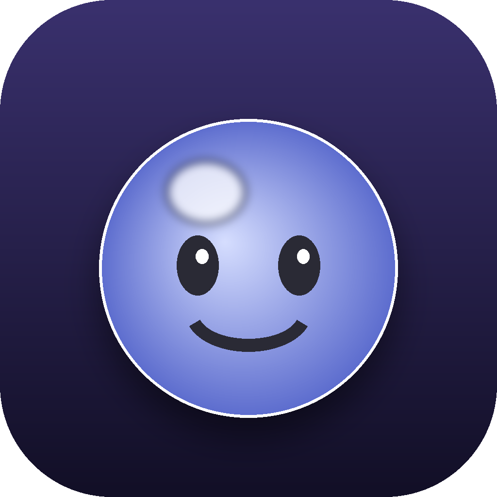

# 🫧 Squish — a translucent 3D desktop stress ball

A squishy, see-through stress ball that lives on your desktop in its own
window. It's a real 3D ball you can **spin a full 360°**, **squish**, and bat
around the screen — rendered with WebGL and a physically-based translucent
material so it actually looks like frosted jelly.

> I built this during a stressful stretch of job hunting. Sometimes you just
> need a jiggly blob to poke at.



## ✨ Features

- **Real 3D, real translucency** — a WebGL sphere (Three.js) with a
  physically-based glassy material: soft refraction, a clearcoat sheen, and
  environment lighting. You can spin it around to see every side.
- **Grab to spin *and* squish** — press and drag to rotate the ball 360° while
  mashing it; the faster you drag, the more it deforms. Let go and it flings.
- **Springy squash-and-stretch** — a hand-rolled spring makes it jiggle on
  every hit, bounce and wall-smack.
- **Click-to-rev energy** — rapid clicking pumps it up so it ricochets harder;
  stop and it calms down and drifts back to the middle.
- **Motion-speed control** — a comfort slider caps how fast it moves. Turn it
  down for a gentle, slow drift (helpful if fast motion bothers you); turn it
  up for chaos.
- **Sparkles** — a little burst of light every time you squish it. ✨
- **Ball · Fruit · Veggie** — a colour ball or a translucent piece of fruit/veg,
  each with a simple smile you can toggle off.
- **Settings that stick** — type, colour, transparency, motion speed, smile,
  sound and "keep on top" are all adjustable and remembered between launches.
- **Desktop-pet mode** — as an app it has no window or frame: just the ball,
  floating and wandering over your whole desktop, always on top. Clicks pass
  straight through to your desktop everywhere *except* on the ball, so nothing
  gets in your way. Leave it alone for 3 minutes and it curls up to doze near
  the Dock (😴 zzz); click it to wake it. A menu-bar icon lets you wake it,
  rest it, re-centre it, or quit.
- **Offline-friendly** — the 3D library is bundled in the repo; nothing is
  fetched at runtime except an optional web font.

## 🚀 Run it as a desktop app

You'll need [Node.js](https://nodejs.org) installed (it includes `npm`).

```bash
npm install      # grabs Electron (first time only)
npm start        # launches Squish in its own window
```

### Make an installable app (with the icon)

```bash
npm run dist
```

The finished app lands in `dist/` — a `.dmg` on macOS, an installer and a
portable `.exe` on Windows, an `AppImage` on Linux. (Build installers for an OS
*on* that OS.)

### Quitting

Since the floating ball has no window chrome, quit from the **menu-bar (tray)
icon → Quit Squish**, or right-click the icon in the Dock → Quit.

## 🖱️ Just want a quick look?

Open **`renderer/index.html`** in any modern browser — it works without Node and
shows the ball on a backdrop (the transparent floating behaviour is only in the
desktop app).

## 🎮 Controls

| Action | What it does |
| --- | --- |
| Click / tap | Bounce + squish + sparkles |
| Click fast, over and over | Builds energy → faster, wilder bouncing |
| Press + drag | Spin the ball 360° and squish it; release to fling |
| Space bar | Bounce |
| ⚙️ Settings | Appearance (dark/light), type, colour, **size**, transparency, **motion speed**, smile, sound, keep-on-top |

Open Settings from the **menu-bar icon → Settings…**, or move the pointer to
the top-right corner of the screen to reveal the ⚙️ gear. Size ranges from the
full ball down to one third of it. Fruit and veggies take their real shape (a
pineapple looks like a pineapple) with a little smile on top.

## 🧠 How it works

The ball is a Three.js `MeshPhysicalMaterial` sphere with **transmission**
(the glassy, see-through part), lit by an ambient + two directional lights and
a small procedural environment map so the surface has something to reflect. The
transparency slider drives the material's transmission and opacity together, so
it goes from a solid coloured ball to ghostly glass.

Motion is a tiny physics loop. The ball carries a position and velocity in 3D
space and bounces off the edges of the view; an **energy** value (0–1) climbs
with each click and decays over time, scaling both the impulse per click and
the speed cap — and everything is multiplied by the **motion-speed** setting so
you can make it as calm or as frantic as you like. The jiggle is a damped
spring on a squash value that flattens and bulges the sphere (squash-and-
stretch). Dragging feeds pointer movement straight into the ball's rotation
(plus angular momentum for the spin-after-release) and into the squash, so a
grab both turns and mashes it. The face and fruit/veg are painted onto a 2D
canvas that's wrapped on the sphere as a texture.

Electron wraps it all in a native window; a small preload bridge lets Settings
ask the window to stay on top.

## 🎨 Customising

Skins live at the top of `renderer/script.js`:

```js
const BALL_COLORS = ["#8C9EFF", /* add a hex */ ];
const FRUITS  = ["🍎", "🍊", /* emoji */ ];  const F_TINTS = ["#E8614D", /* its tint */ ];
const VEGGIES = ["🥦", "🥕", /* emoji */ ];  const V_TINTS = ["#6BBF59", /* its tint */ ];
```

Swap `build/icon.png` for your own 1024×1024 image to change the app icon.

## 🛠 Tech

Electron · Three.js / WebGL · vanilla JavaScript · CSS · Web Audio API ·
Pointer Events. No UI frameworks.

## 📄 License

MIT — see [LICENSE](LICENSE).
